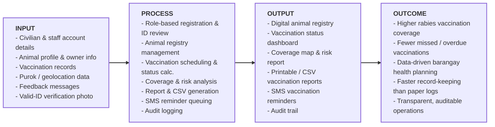
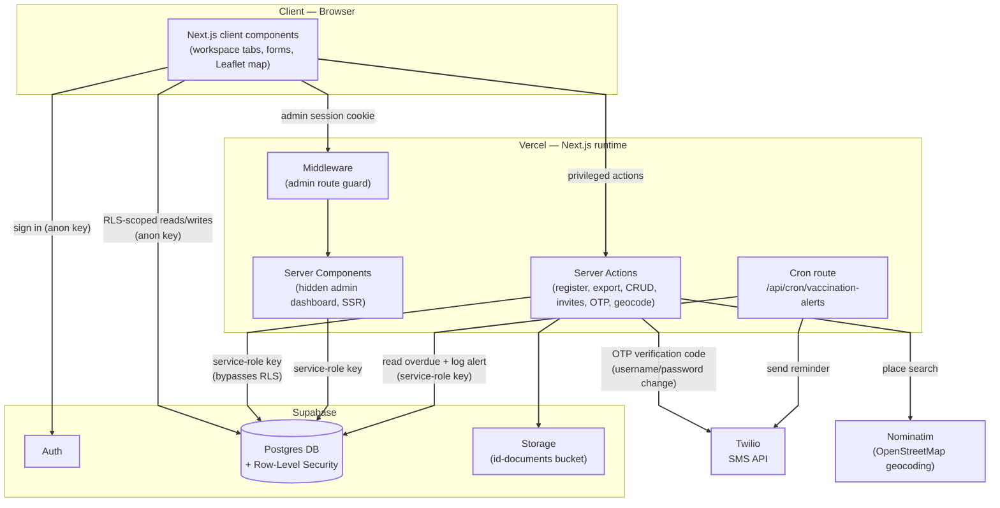
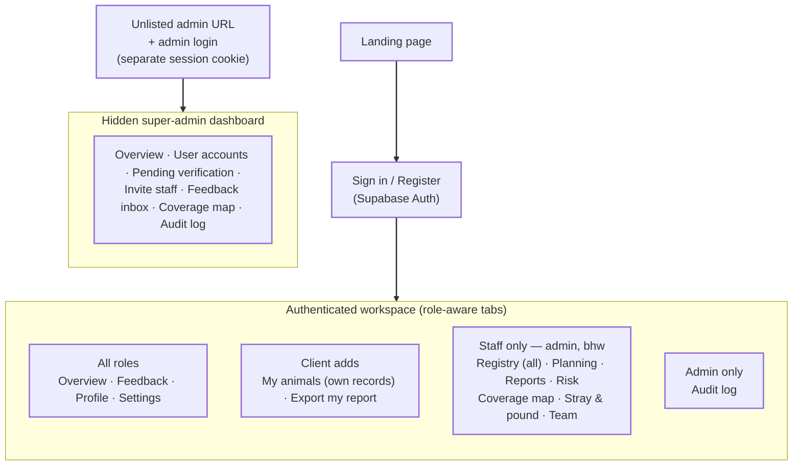
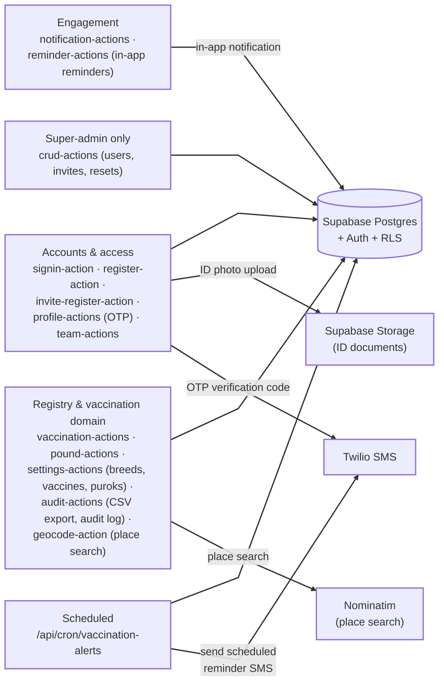
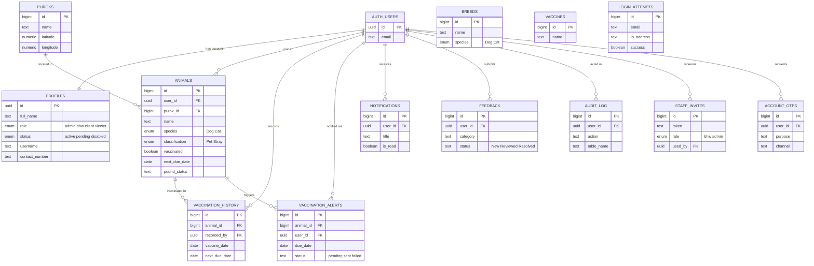
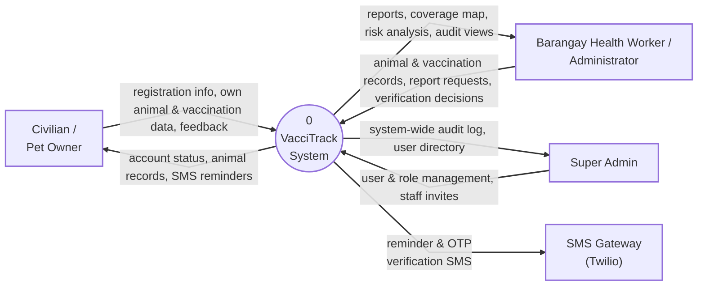
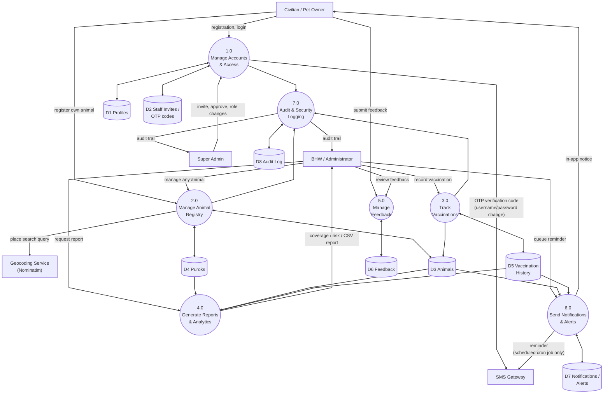
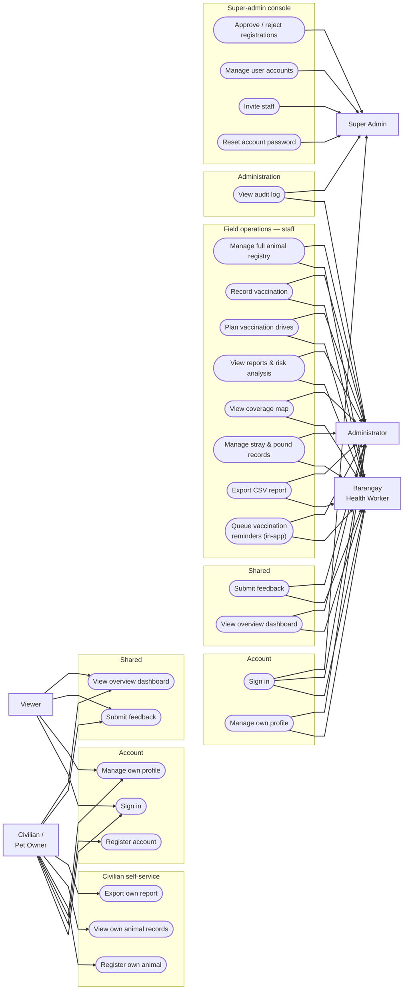

# VacciTrack — System Diagrams

Mermaid source for the capstone documentation set. Paste any block below into
the [Mermaid Live Editor](https://mermaid.live), a Mermaid-aware Notion/Confluence
page, or a `.md` file rendered on GitHub/GitLab — no changes needed.

## IPOO

## System Architecture

## Front-end

## Back-end

## ERD

Every foreign key below is drawn from the table it actually references in
`supabase/schema.sql` — most of them point straight at `auth.users`, not at
`profiles` (`profiles.id` is itself just a 1:1 extension of `auth.users`).
`breeds`, `vaccines`, and `login_attempts` are included as standalone tables:
`animals.breed`/`vaccine_type` are free-text (no FK to `breeds`/`vaccines`),
and `login_attempts` is keyed by the attempted email, not a user id — so none
of the three have a relationship to draw.

## DFD — Level 0 (Context Diagram)

## DFD — Level 1

## Use Case Diagram

