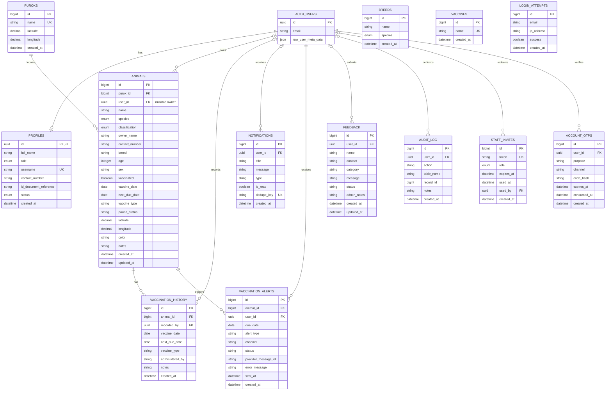
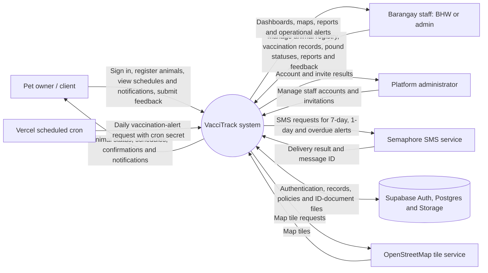
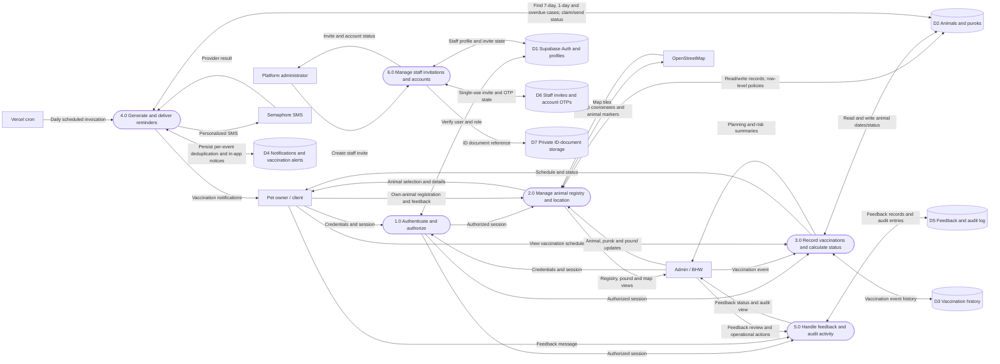
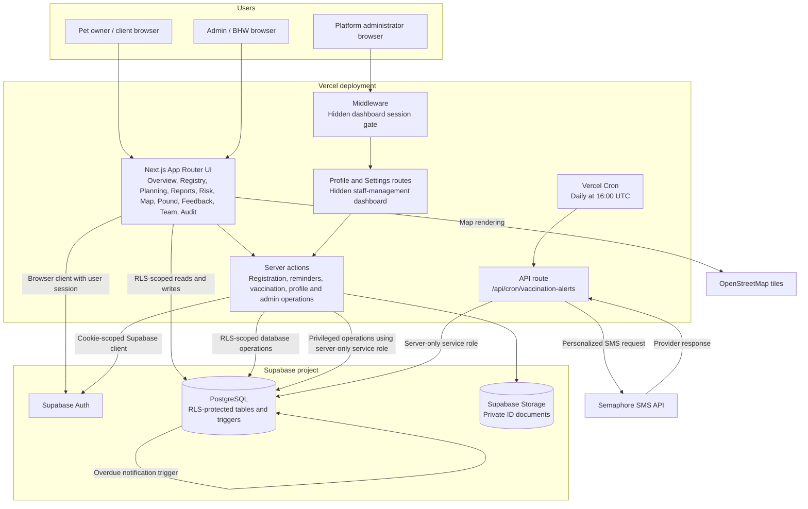
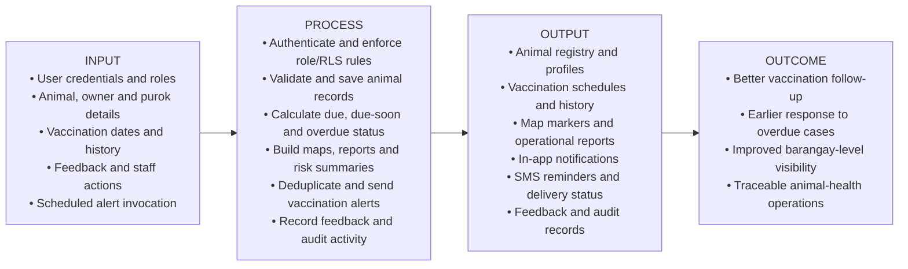
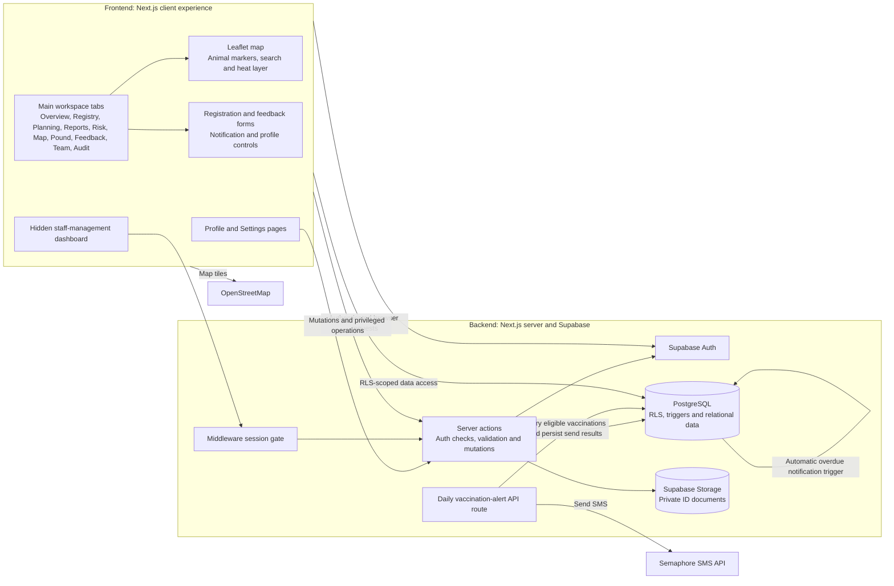

# VacciTrack System Diagrams

These diagrams describe the current Next.js and Supabase implementation. `profiles`, `animals`, `puroks`, `vaccination_history`, `notifications`, and `vaccination_alerts` are defined in `supabase/schema.sql`. Breed and vaccine names are currently stored as text on animal/history records; the `breeds` and `vaccines` lookup tables are not foreign-keyed to those fields.

## ERD

`LOGIN_ATTEMPTS` has no foreign key. Animal `breed` and `vaccine_type` are text values rather than references to `BREEDS` and `VACCINES`. Animal photos are not currently represented in the schema.

## DFD Level 0: Context

## DFD Level 1: Core Processes and Data Stores

## System Architecture

The Supabase service-role key and Semaphore API key are server-only. Browser and cookie-scoped clients use the authenticated user's session and are subject to row-level security. The hidden dashboard has an additional middleware cookie gate.

## IPOO

## Frontend and Backend

Current implementation note: animal records and client/server views do not have a pet-photo column or upload workflow. The only image storage flow is private ID-document upload during account registration.
