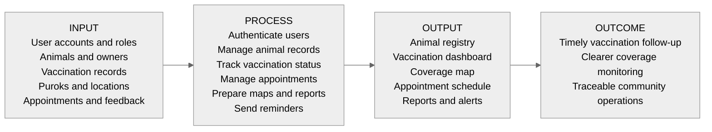
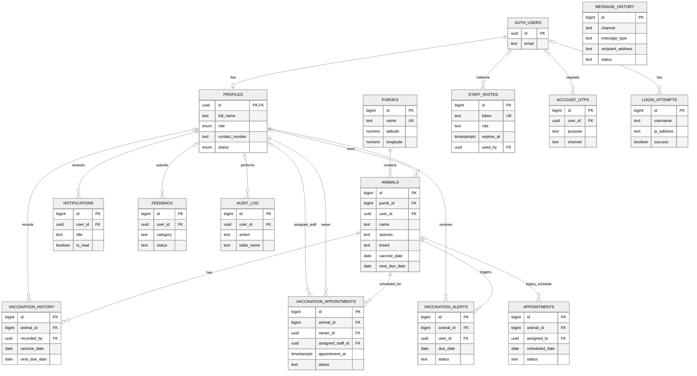
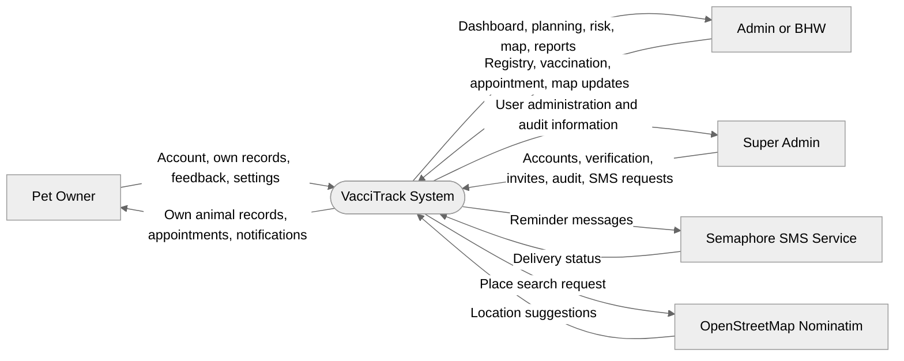
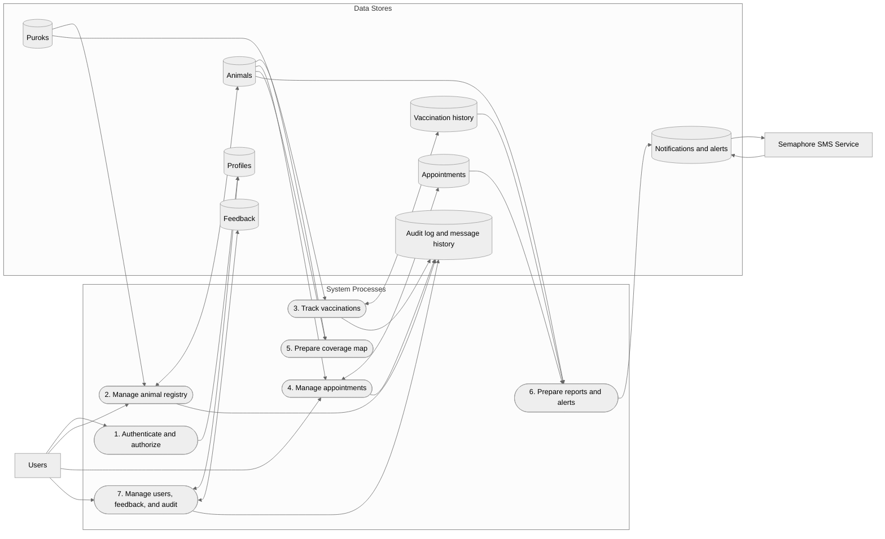
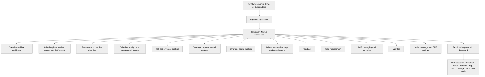
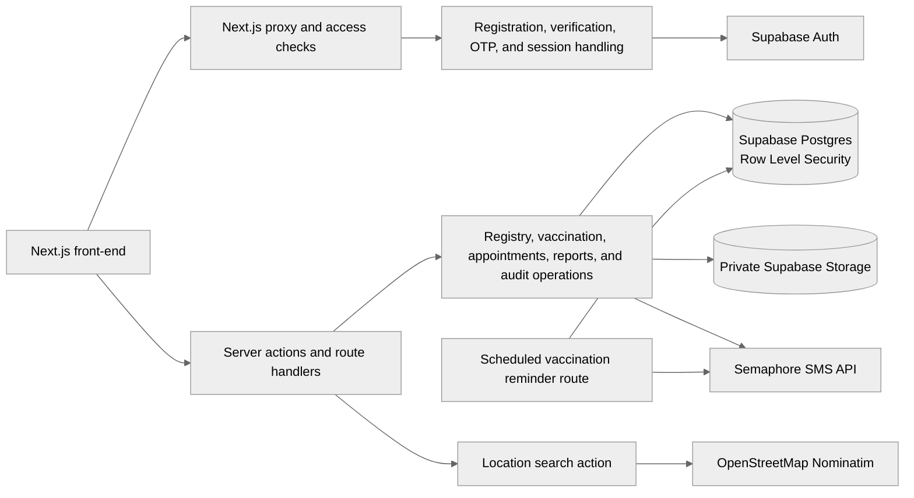
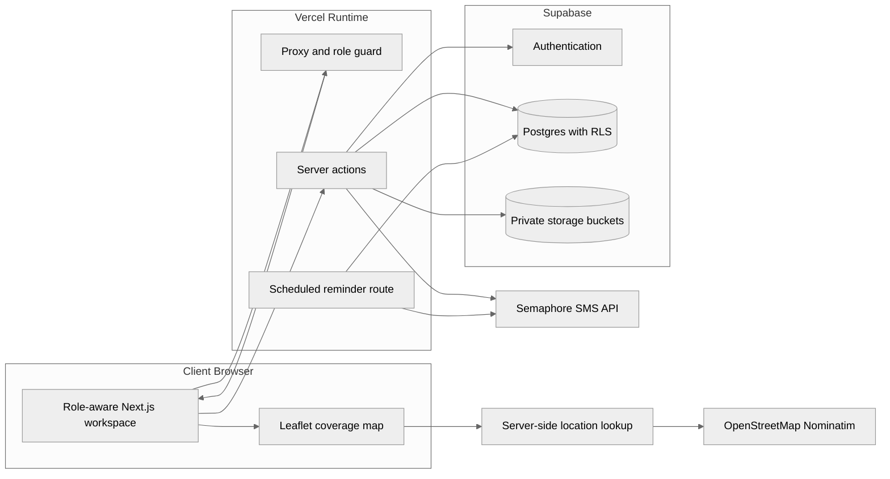

# VacciTrack Diagrams

These diagrams summarize the implemented VacciTrack system. They use Mermaid's neutral theme for a simple black-and-white appearance.

## Implemented Features

- **Accounts and access:** registration and sign-in, role-based workspaces, account verification, staff invitations, profile settings, English/Tagalog/Hiligaynon language preference, password recovery, and SMS one-time codes for supported account changes. Roles include client, BHW, and admin; super-admin tools are provided through a separate restricted dashboard.
- **Animal registry:** register and update dogs and cats, pet or stray classification, owner/contact details, breed, age, sex, neuter status, notes, vaccination details, location, and identification photos. Staff can search/filter records, view animal profiles, and export registry data as CSV.
- **Vaccination tracking:** vaccination history, due and overdue status, planning lists, vaccine reference data, dashboard counts, and risk/coverage summaries by purok and animal groups. Dashboard data refreshes every 30 seconds and when the browser regains focus.
- **Appointments:** staff can schedule visits, assign staff, and update appointment status; owners can view their own appointments.
- **Maps and location:** Leaflet coverage maps, map pins, purok coverage, search and filters, clusters, heat density, location selection, and place lookup through OpenStreetMap Nominatim.
- **Reports and stray/pound records:** animal, vaccination, map/coverage, and stray/pound reports with PDF, Word, Excel, CSV, and print options; track impound area and statuses for observation, adoption, or reclamation.
- **Notifications and messaging:** in-app notifications, scheduled vaccination reminders, staff SMS messaging, delivery/message history, and SMS audit records through Semaphore.
- **Operations and administration:** team management, user verification and account management, staff invites, feedback handling, audit log, and SMS testing/custom messages.

## IPOO

## Entity Relationship Diagram (ERD)

The ERD focuses on the main records used by the registry, vaccination, and appointment workflows.

## Data Flow Diagram (DFD) - Level 0

## Data Flow Diagram (DFD) - Level 1

## Front-end

## Back-end

## System Architecture

