# VacciTrack System Documentation

This document describes the implemented Next.js, Supabase, Vercel, and Semaphore system. It replaces the older duplicate diagram and task-tracking documents.

## System Objectives

| Objective | Implemented area |
|---|---|
| 1 | Live vaccination monitoring, status calculation, notifications, and dashboard refresh |
| 2 | Geospatial mapping, purok coverage, filters, heatmap, and clusters |
| 3 | Refer to the capstone proposal for the exact external objective text |
| 4 | Staff scheduling and tracking of vaccination appointments |
| 5 | Dashboard and registry reporting, coverage breakdowns, and exports |

## System Architecture

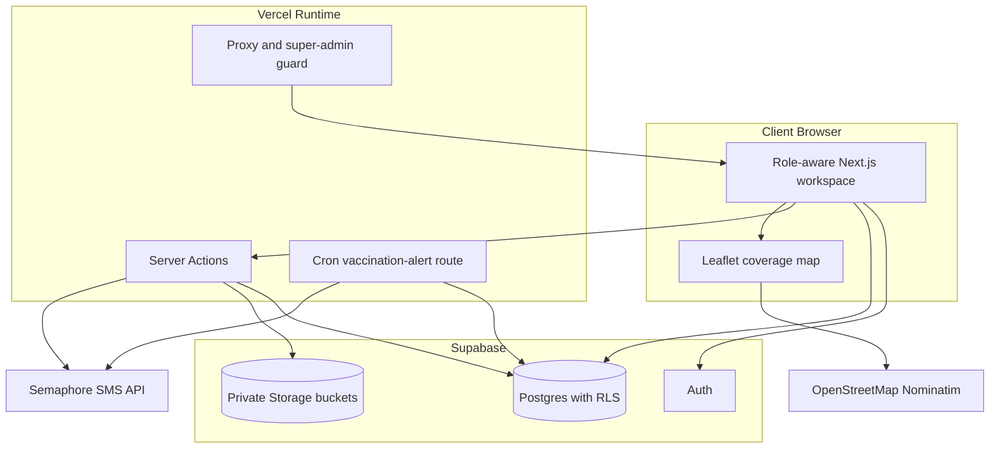

## IPOO

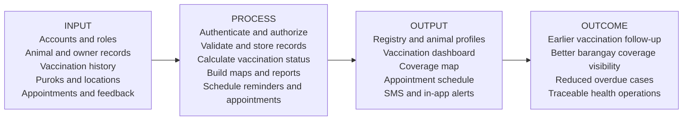

## Data Flow Diagram - Level 0

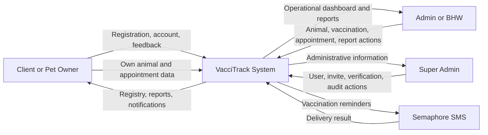

## Data Flow Diagram - Level 1

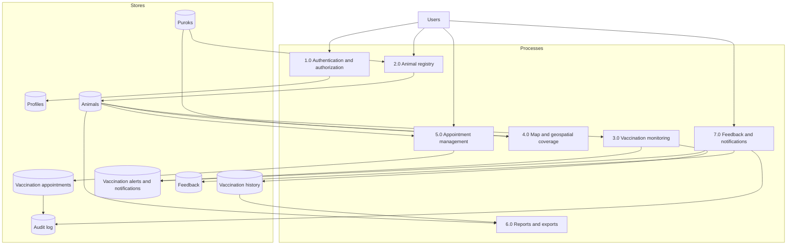

## Entity Relationship Diagram

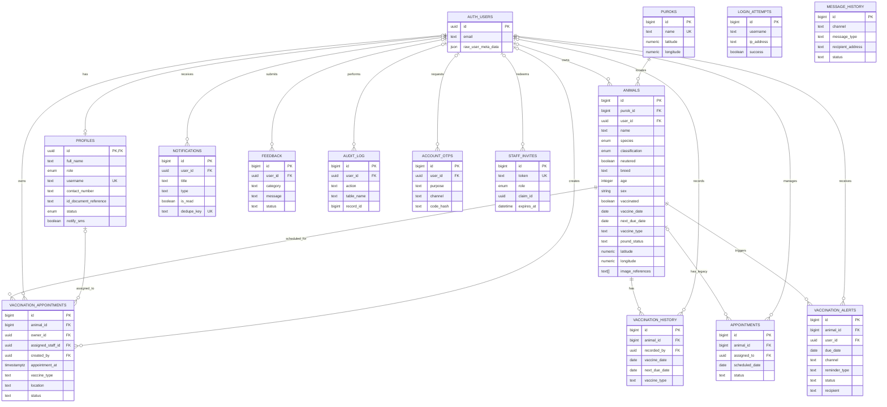

## Front-end and Role Views

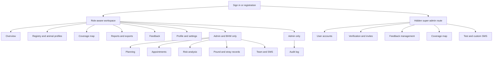

## Storage and Security

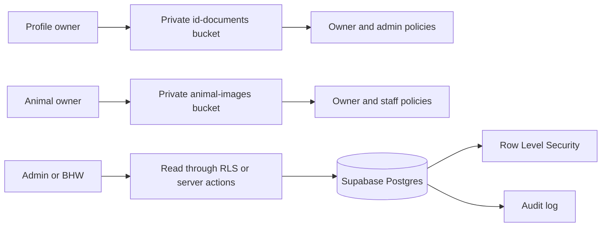

## Objective 1 Monitoring

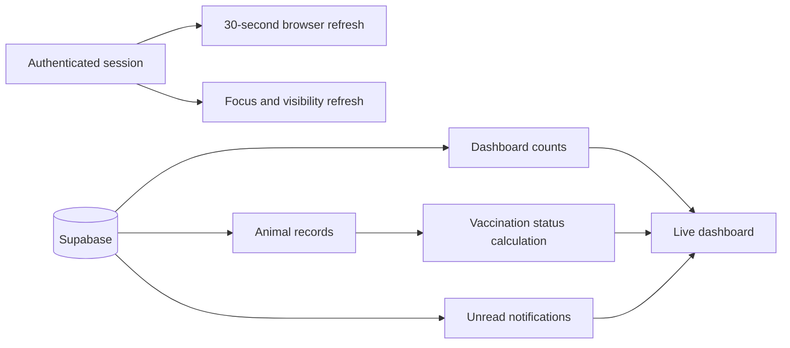

## Objective 2 Geospatial Coverage

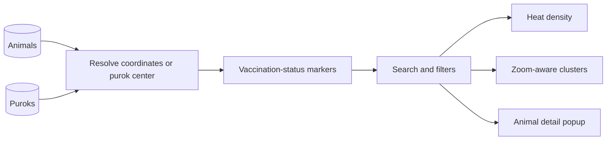

## Objective 4 Appointments

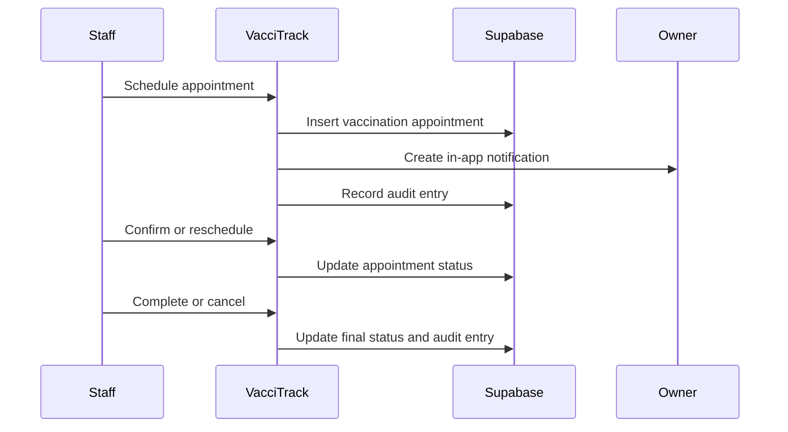

## Objective 5 Reports

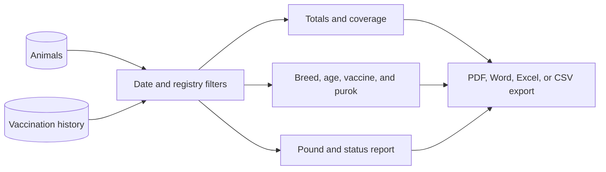

## Implementation Note

`vaccination_appointments` is the detailed appointment workflow used by the current implementation. `appointments` remains in the schema for compatibility with the legacy appointment model. Animal breed and vaccine type are text fields rather than foreign keys to `breeds` and `vaccines`.
