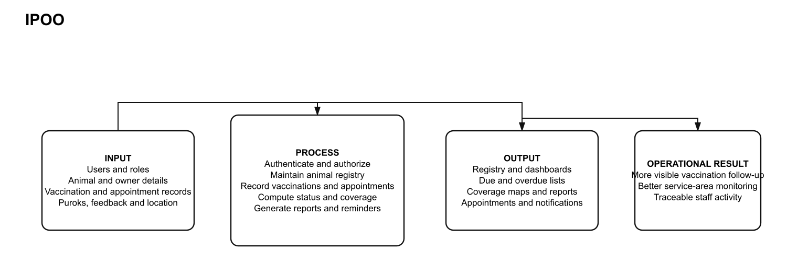
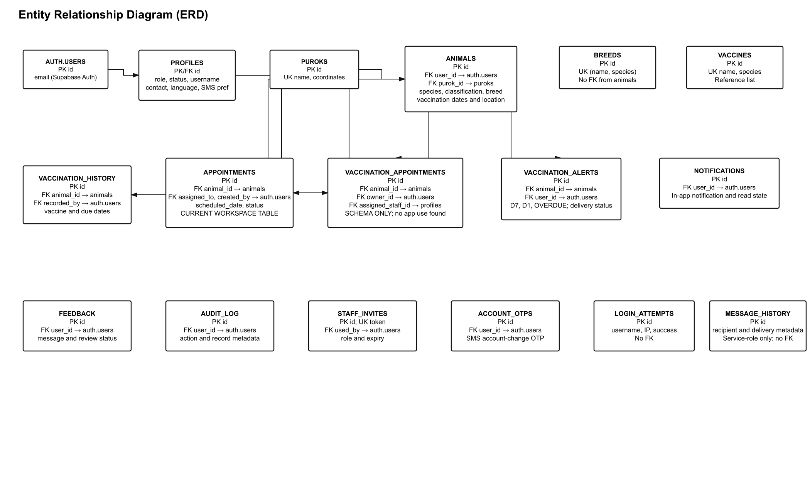
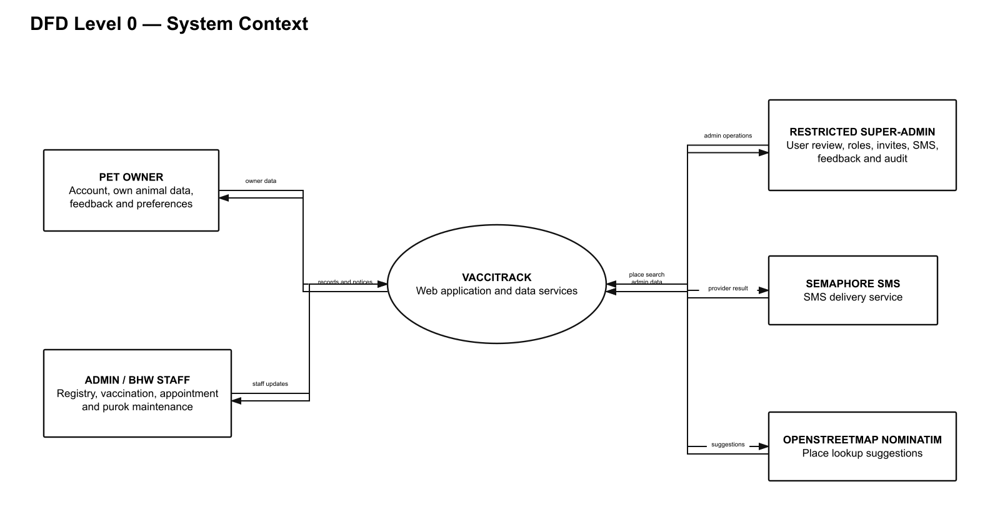
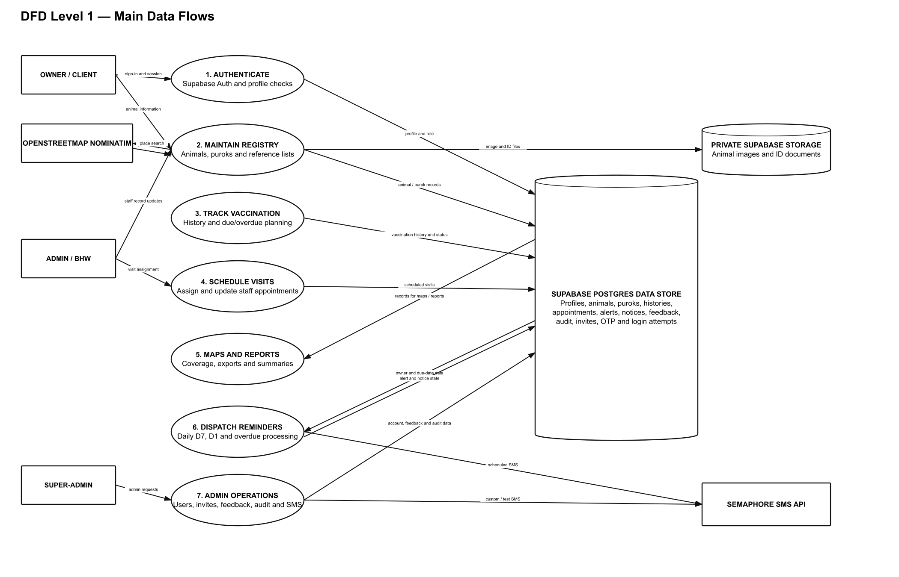
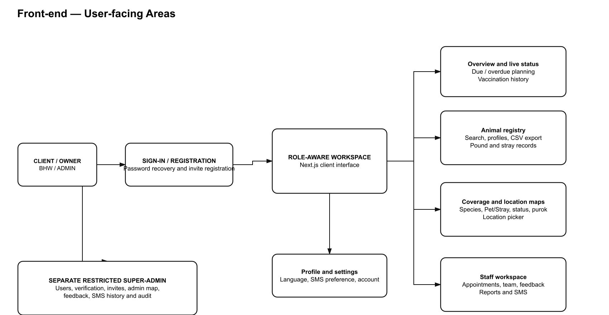
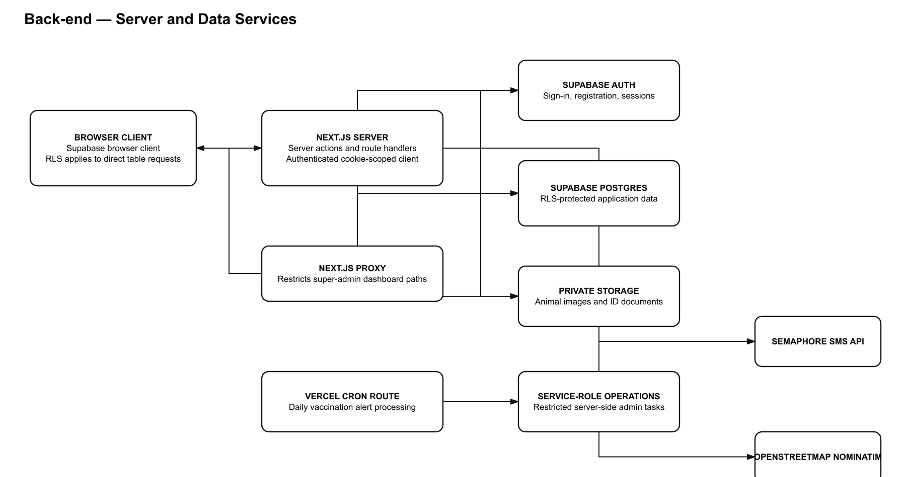
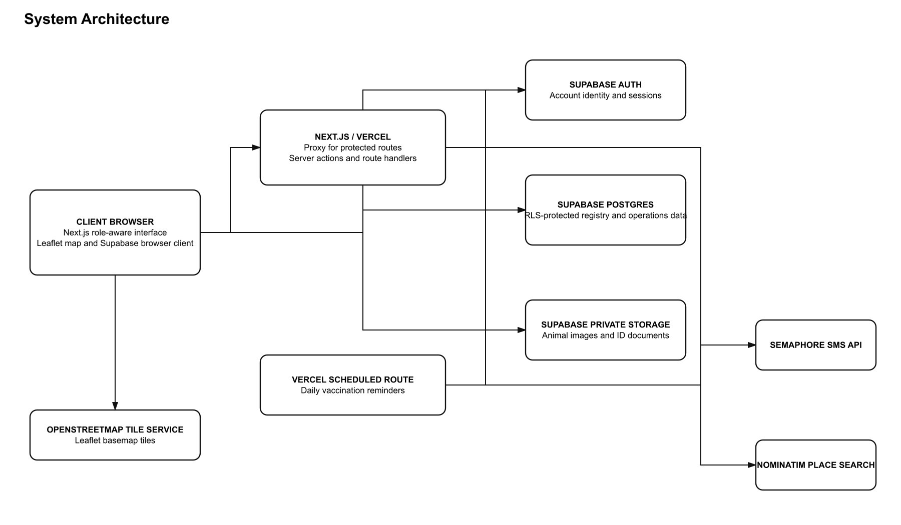

# VacciTrack System Diagrams

These diagrams are rebuilt from the current application code and [Supabase schema](../supabase/schema.sql). They describe implemented behavior and identify schema-only records explicitly. The editable Draw.io files and their grayscale PNG previews are kept beside this Markdown file.

## Implemented behavior represented

- Accounts use Supabase Auth and profiles for client, BHW, admin, and viewer roles; a separate restricted super-admin login handles account operations.
- Animal records, puroks, vaccination history, staff-assigned appointments, feedback, notifications, audit events, SMS metadata, and reminder delivery records are persisted in Supabase Postgres.
- The browser uses a Supabase client with RLS for permitted reads and writes. Server actions and route handlers use cookie-scoped access or server-only service-role access where required.
- Private Supabase Storage holds animal images and registration ID documents.
- A Vercel scheduled route processes D7, D1, and overdue vaccination alerts and sends SMS through Semaphore. Location search uses a server action and OpenStreetMap Nominatim.

## IPOO

The final box is an intended operational result, not a directly measured system output.

## ERD

This follows declared foreign keys in supabase/schema.sql. auth.users is Supabase-managed. appointments is used by current workspace actions. vaccination_appointments exists in the schema but has no application usage found. breeds and vaccines are reference tables; animal breed and vaccine type are text fields without foreign keys.

## DFD Level 0

Shows the system boundary and the external actors and services exchanging data with VacciTrack.

## DFD Level 1

Breaks the application into its principal processes and data exchanges. Arrows summarize the system flows rather than each individual database query.

## Front-end

Shows role-specific workspace areas and the separate super-admin entry point.

## Back-end

Shows browser-side Supabase access with RLS, cookie-scoped server operations, service-role operations, storage, scheduled reminders, and external services.

## System Architecture

Shows runtime boundaries and the browser, Vercel/Next.js, Supabase, Semaphore, Nominatim, and OpenStreetMap tile-service connections.

